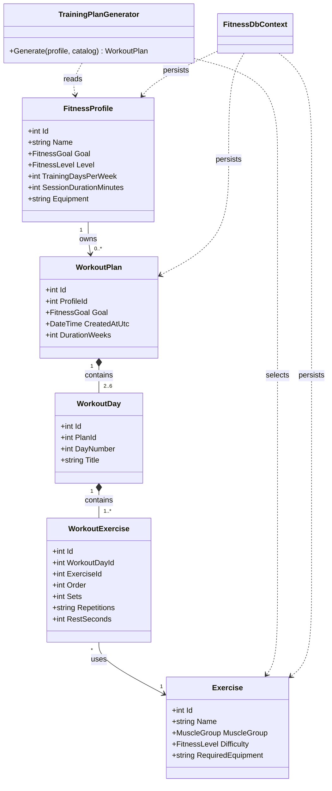

# Фитнес-платформа: индивидуальный план тренировок

Консольное приложение на C# / .NET 10 для создания профиля занимающегося и формирования персонального недельного плана упражнений. Профили, каталог упражнений и планы сохраняются в SQLite с помощью Entity Framework Core.

## Запуск

Из каталога проекта выполните:

```powershell
dotnet restore
dotnet run
```

При первом запуске приложение создаёт `fitness.db` и наполняет каталог базовыми упражнениями. Файл базы данных создаётся в текущем рабочем каталоге.

## Возможности

- Создание профиля: цель, уровень подготовки, число тренировок в неделю, длительность занятия и доступный инвентарь.
- Формирование четырёхнедельного плана с подбором упражнений по уровню и инвентарю.
- Разделение занятий на тренировки всего тела, верх/низ или толкающие/тянущие группы — в зависимости от числа занятий.
- Подбор количества подходов, повторений и отдыха в соответствии с целью и уровнем.
- Просмотр профилей и ранее сохранённых планов.

Для упражнений без инвентаря не требуется указывать оборудование. Для прочих упражнений укажите совпадающие названия через запятую: `гантели`, `эспандер`.

## Архитектура

- **Models** — сущности предметной области и перечисления.
- **Data** — контекст EF Core, конфигурация связей и начальный каталог упражнений.
- **Services** — алгоритм составления плана и безопасное чтение пользовательского ввода.
- **Program.cs** — консольное меню и сценарии взаимодействия.

## UML-диаграмма классов



## Примечание

План носит информационный характер и не является медицинской рекомендацией. При боли, травмах или хронических заболеваниях следует проконсультироваться со специалистом.
